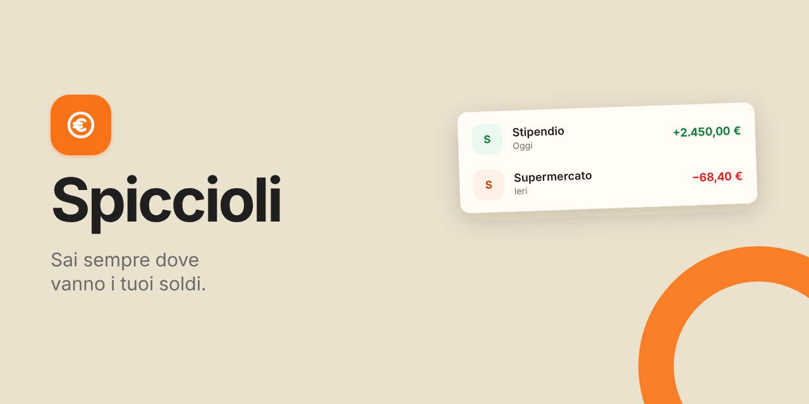

# Spiccioli

Un'app per tenere sotto controllo entrate e uscite, con un piano mensile e le spese ricorrenti.

È un **progetto didattico**: nasce per imparare C#/.NET e React da zero, costruendo un'applicazione completa un passo alla volta. Il codice è ricco di commenti proprio per questo.

Online: https://spiccioli-silk.vercel.app

## Cosa fa

- Movimenti (entrate e uscite) con categorie, filtri e ricerca
- Piano del mese: entrate previste, risparmio e importo previsto per categoria, confrontati con il reale
- Spese ricorrenti (affitto, abbonamenti, rate) con calendario delle scadenze e pulsante "Pagato"
- Panoramica con totali e uscite per categoria
- Accesso con email o con Google
- Impostazioni: nome visualizzato, tema chiaro, scuro o del sistema, esportazione dei movimenti in CSV, cambio password (account con email) ed eliminazione dell'account con tutti i dati
- Informativa privacy e installazione sul telefono come app (PWA, senza modalità offline)

## Tecnologie

- **Backend:** .NET 10, ASP.NET Core Web API, Entity Framework Core, test con xUnit
- **Database e accesso:** PostgreSQL e autenticazione su Supabase (JWT)
- **Frontend:** React, TypeScript, Vite, React Router, TanStack Query, CSS
- **Pubblicazione:** Vercel (frontend), Render con Docker (backend), Supabase (database e accesso), UptimeRobot (controllo di `/health`)

## Pubblicazione

Tutto sui piani gratuiti. Nessun segreto è nel repository: si impostano nei servizi.

- **Backend su Render** (servizio web con Docker, Root Directory `backend`, Health Check Path `/health`). Variabili d'ambiente:
  - `ConnectionStrings__DefaultConnection`: la stringa del Session pooler di Supabase (il collegamento diretto non funziona da Render, perché usa solo IPv6)
  - `Supabase__SecretKey`: la chiave segreta di Supabase
  - `Cors__AllowedOrigins__0`: l'indirizzo del sito, senza `/` finale
- **Frontend su Vercel** (Root Directory `frontend`, preset Vite). Variabili d'ambiente: `VITE_API_URL`, `VITE_SUPABASE_URL`, `VITE_SUPABASE_PUBLISHABLE_KEY`. Il file `frontend/vercel.json` fa servire `index.html` a ogni indirizzo, per le pagine di React Router.
- **Supabase:** in Authentication → URL Configuration, Site URL e Redirect URLs con l'indirizzo del sito (e quelli di `localhost` per lo sviluppo).
- **UptimeRobot:** un controllo ogni 5 minuti su `/health`, che interroga anche il database: tiene sveglio il server (il piano gratuito di Render lo spegne dopo 15 minuti di inattività) e il database (Supabase mette in pausa i progetti inattivi).

## Stato del progetto

- Backend completo e testato (58 test)
- Frontend completo: accesso, movimenti, categorie, spese ricorrenti, piano del mese, panoramica, impostazioni, tema chiaro e scuro, accessibilità
- Pubblicato online, installabile sul telefono (PWA)